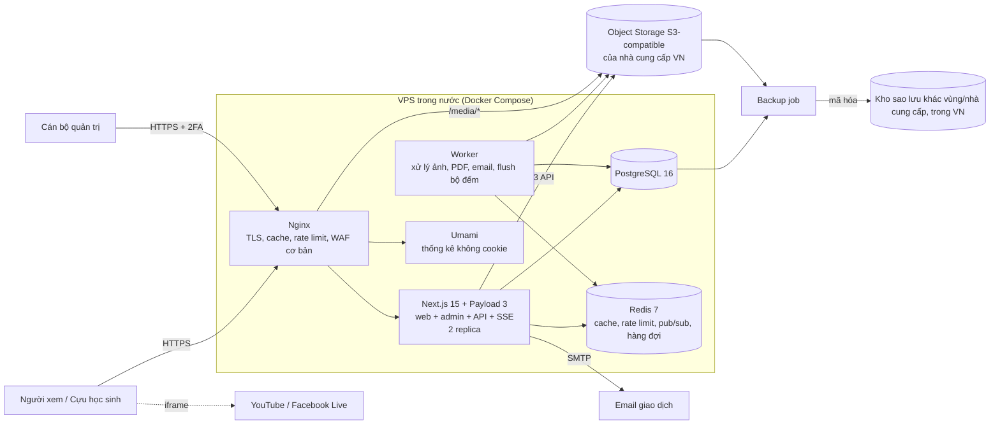
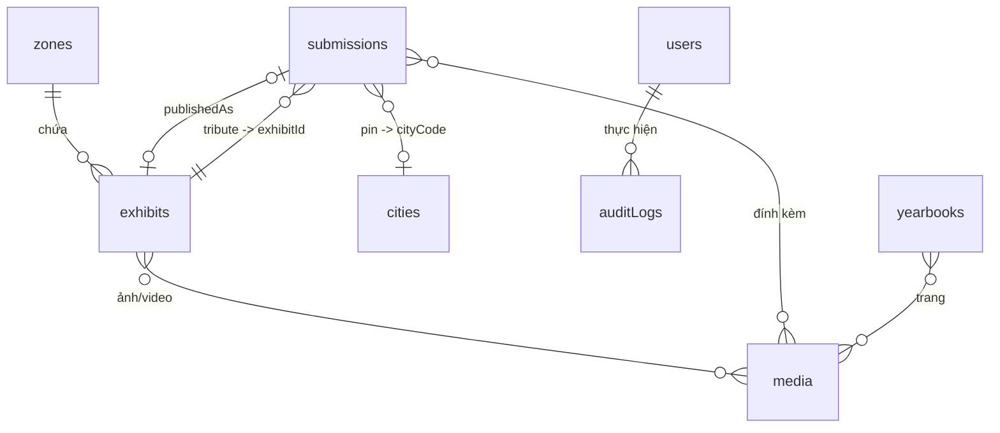
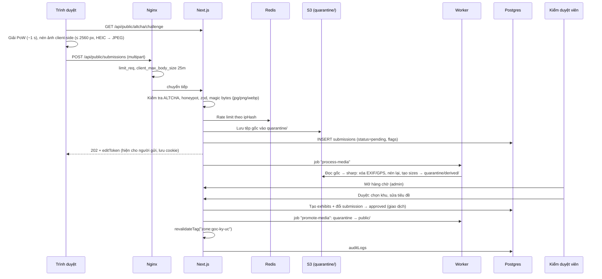

# Thiết kế kỹ thuật – Phòng truyền thống trực tuyến Trường THPT Sông Công (1986 – 2026)

| Mục | Nội dung |
|---|---|
| Mã dự án | BossS |
| Phiên bản | 1.0 (bản nháp để review) |
| Ngày | 18/10/2026 |
| Đơn vị thực hiện | THD CyberSecurity |
| Khách hàng | Trường THPT Sông Công, Thái Nguyên |
| Mốc cứng | **Đại lễ 40 năm: 07:30, thứ Sáu 20/11/2026** |
| Đầu vào | Bản prototype HTML "Phòng truyền thống trực tuyến – Trường THPT Sông Công 1986 – 2026" (artifact Claude) |

---

## 0. Tóm tắt

Chuyển bản prototype (một tệp HTML chạy trên hạ tầng artifact của claude.ai) thành một **website độc lập, chạy trên VPS/cloud trong nước**, do nhà trường sở hữu dữ liệu và THD vận hành.

Ba quyết định đã chốt:

1. **Hạ tầng:** VPS/cloud tại Việt Nam (Viettel IDC, VNPT hoặc FPT Cloud), triển khai bằng Docker Compose.
2. **Người gửi nội dung không cần tài khoản.** Chống spam bằng proof-of-work tự host, giới hạn tần suất và **kiểm duyệt trước 100%** nội dung người dùng gửi lên.
3. **Phạm vi:** MVP đầy đủ E2E kịp ngày 20/11/2026. Các phần phụ được chuyển sang giai đoạn 2.

Stack: **Next.js 15 (App Router) + Payload CMS 3 (nhúng chung ứng dụng) + PostgreSQL 16 + Redis 7 + lưu trữ đối tượng S3-compatible + Nginx**. Chỉ một ứng dụng và một repo, đủ cho đội nhỏ làm trong 4 tuần.

**Đường găng thực sự là tư liệu thật của nhà trường, không phải phần mềm.** Tiến độ thu thập nội dung được theo dõi song song với tiến độ code (mục 15).

---

## 1. Bối cảnh, mục tiêu, phạm vi

### 1.1 Mục tiêu

| # | Mục tiêu | Thước đo |
|---|---|---|
| G1 | Số hóa phòng truyền thống: 8 khu trưng bày với tư liệu thật | ≥ 90% mục trong danh mục tư liệu (do trường cung cấp) được đăng trước 15/11 |
| G2 | Kết nối cựu học sinh hướng về Đại lễ | Lời chúc, kỷ vật, ghim bản đồ, nến tri ân; mọi nội dung được duyệt trong ≤ 24 giờ (≤ 15 phút vào ngày lễ) |
| G3 | Phát trực tiếp Đại lễ ổn định | Trang chịu được 3.000 người xem đồng thời, p95 < 500 ms, không gián đoạn trong khung 07:00 – 11:30 ngày 20/11 |
| G4 | An toàn, đúng pháp luật | Không có lỗ hổng mức Cao hoặc Nghiêm trọng khi go-live; tuân thủ Luật BVDLCN 2025 |
| G5 | Nhà trường tự vận hành nội dung | Cán bộ trường tự thêm, sửa, duyệt nội dung sau 1 buổi tập huấn |

### 1.2 Phạm vi giai đoạn 1 (đến 20/11)

**Trong phạm vi:**
- Gian trung tâm.
- 8 khu trưng bày.
- Góc ký ức và chiến dịch "Gửi kỷ vật".
- Hộp ký ức ngẫu nhiên.
- Trang Đại lễ: đếm ngược, phát trực tiếp nhúng, thả cảm xúc, số người xem, sổ lời chúc, thắp nến, lời tri ân bằng chữ, quỹ học bổng, câu đố, bản đồ cựu học sinh.
- Kỷ yếu lật trang.
- Nhạc nền.
- Trang quản trị: CMS, kiểm duyệt, phân quyền, nhật ký.
- Sao lưu, giám sát, kiểm thử E2E.

**Ngoài phạm vi, chuyển giai đoạn 2:**

| Hạng mục | Ghi chú |
|---|---|
| Tham quan 3D | Giữ liên kết ngoài nếu đã có bản dựng |
| Lời tri ân bằng ghi âm | |
| Cổng thanh toán trực tuyến cho quỹ | Giai đoạn 1 dùng chuyển khoản qua QR và tự báo đóng góp |
| Đăng nhập cựu học sinh | Google, Zalo |
| Đa ngôn ngữ | |
| Ứng dụng di động | |

### 1.3 Giả định

- Nhà trường là **bên kiểm soát dữ liệu**, THD là **bên xử lý dữ liệu** theo hợp đồng.
- Video lễ được phát trên kênh YouTube hoặc Facebook của trường. Website chỉ nhúng luồng, không tự phát video.
- Tên miền: dùng tên miền giáo dục do Sở GD&ĐT cấp (dạng `*.thainguyen.edu.vn`) hoặc tên miền `.edu.vn` của trường. Cần chốt trước **25/10** (xem mục 18).
- Đội thực hiện: 1 trưởng kỹ thuật full-stack, 1 frontend, 0,5 DevOps/bảo mật (THD); phía trường có 1 đầu mối nội dung và 2 – 3 người kiểm duyệt.

---

## 2. Người dùng và vai trò

| Vai trò | Xác thực | Quyền chính |
|---|---|---|
| Khách (công chúng, cựu học sinh) | Không | Xem nội dung đã duyệt; gửi lời chúc, kỷ vật, ảnh, lời tri ân, ghim bản đồ, báo đóng góp; thắp nến; thả cảm xúc |
| Biên tập viên khu (Văn phòng, Đoàn) | Tài khoản + 2FA | Thêm, sửa, ẩn mục **chỉ trong các khu được giao** (thực thi ở server) |
| Kiểm duyệt viên (Ban liên lạc cựu học sinh) | Tài khoản + 2FA | Duyệt hoặc từ chối nội dung người dùng gửi lên; quản lý khu Cựu học sinh, Góc ký ức |
| Quản trị trường (Ban Giám hiệu) | Tài khoản + 2FA | Toàn quyền nội dung, cấu hình Đại lễ, quỹ, tài khoản người dùng |
| Quản trị kỹ thuật (THD) | Tài khoản + 2FA + mạng quản trị | Hạ tầng, sao lưu, cấu hình bảo mật; **không** sửa nội dung nếu không có yêu cầu bằng văn bản |

Bài học từ prototype: phân quyền theo khu **phải được thực thi trên server** (access control của Payload), không chỉ ẩn trên giao diện.

---

## 3. Yêu cầu chức năng

Mức ưu tiên: **P0** là bắt buộc cho 20/11, **P1** là nên có cho 20/11, **P2** chuyển giai đoạn 2.

### 3.1 Trang công khai

| ID | Chức năng | Ưu tiên | Ghi chú triển khai |
|---|---|---|---|
| F-01 | Gian trung tâm: băng rôn, Quyết định thành lập (xem ảnh scan), dòng thời gian | P0 | Dữ liệu lấy từ `SiteSettings` và `Milestones` |
| F-02 | 8 khu trưng bày: lưới, lọc (thời kỳ, tổ, lĩnh vực, năm), tìm kiếm tiếng Việt không dấu, hộp chi tiết, điều hướng trước/sau | P0 | Dữ liệu từ `Exhibits`; tìm kiếm bằng Postgres `unaccent` + `pg_trgm` |
| F-03 | Khu Cơ sở vật chất: thanh trượt "Ngày ấy – Bây giờ" | P1 | Cặp ảnh có cùng `pairKey` |
| F-04 | Khu Bằng khen: tủ kính theo loại hiện vật | P0 | |
| F-05 | Góc ký ức: kỷ vật theo thế hệ (thập niên) | P0 | |
| F-06 | Hộp ký ức ngẫu nhiên, chọn theo thế hệ | P1 | API trả về một mục ngẫu nhiên đã duyệt; danh sách "đã xem" lưu ở localStorage |
| F-07 | Gửi kỷ vật hoặc ảnh: tối đa 5 ảnh, tên, khóa, loại, câu chuyện, năm, đồng ý điều khoản | P0 | Luồng ở mục 7.2 |
| F-08 | Sổ lời chúc: gửi lời chúc, hiển thị lời chúc đã duyệt (phân trang) | P0 | |
| F-09 | Lời tri ân gửi lãnh đạo hoặc thầy cô (bằng chữ) | P1 | Ghim vào thẻ hồ sơ sau khi duyệt |
| F-10 | Thắp nến tri ân: bộ đếm tổng | P0 | Mỗi trình duyệt 1 lần (cookie ký) và giới hạn theo IP; bộ đếm trong Redis, định kỳ ghi xuống Postgres |
| F-11 | Bản đồ cựu học sinh: thả ghim (tên, khóa, nơi làm việc, thành phố) | P1 | **Phải duyệt trước** khi hiện (khác prototype); vị trí chỉ ở mức thành phố |
| F-12 | Quỹ học bổng: thông tin tài khoản, mã VietQR, thanh tiến độ, form báo đóng góp, danh sách đã xác nhận | P0 | Mã QR sinh từ STK theo chuẩn VietQR, không nhận ảnh QR tải lên (chống tráo QR) |
| F-13 | Đếm ngược Đại lễ; tự chuyển trạng thái trước lễ, đang phát, sau lễ | P0 | Theo `liveMode`: auto, on, off |
| F-14 | Xem trực tiếp: nhúng YouTube hoặc Facebook, khung thu nhỏ khi tham quan, nút mở trên YouTube nếu nhúng lỗi | P0 | Danh sách nguồn nhúng cố định (mục 10) |
| F-15 | Thả cảm xúc theo thời gian thực, số người đang xem | P1 | SSE + Redis (mục 7.4) |
| F-16 | Câu đố 40 năm | P1 | Câu hỏi quản lý trong CMS; chấm điểm phía client |
| F-17 | Kỷ yếu lật trang | P1 | Admin tải PDF lên, server tách thành ảnh từng trang |
| F-18 | Nhạc nền: bật thủ công, không tự phát | P1 | |
| F-19 | Chia sẻ: ảnh OG cho từng trang và từng mục; nút sao chép liên kết, chia sẻ Zalo, Facebook | P1 | |
| F-20 | Chế độ chữ lớn, tương phản cao | P1 | Người dùng lớn tuổi là nhóm đông |
| F-21 | Trang Chính sách quyền riêng tư, Điều khoản gửi nội dung, Liên hệ, yêu cầu gỡ nội dung | P0 | Bắt buộc theo pháp luật |
| F-22 | Tham quan 3D, lời tri ân ghi âm | P2 | |

### 3.2 Quản trị

| ID | Chức năng | Ưu tiên |
|---|---|---|
| A-01 | Đăng nhập, 2FA TOTP, khóa tài khoản sau 5 lần sai, quên mật khẩu qua email | P0 |
| A-02 | CRUD nội dung 8 khu (form theo schema của từng khu, kéo thả sắp xếp, ẩn/hiện, bản nháp/xuất bản) | P0 |
| A-03 | Thư viện media: tải ảnh, video MP4 (admin), PDF; cắt ảnh 4:5; alt text | P0 |
| A-04 | Hàng chờ kiểm duyệt hợp nhất (lời chúc, kỷ vật, ảnh, tri ân, ghim, báo đóng góp): duyệt, sửa rồi duyệt, từ chối kèm lý do, đánh dấu từ ngữ cần chú ý, thao tác hàng loạt | P0 |
| A-05 | Khi duyệt kỷ vật hoặc ảnh: chọn khu đích, cắt chỉnh, gắn tên người trong ảnh | P0 |
| A-06 | Cấu hình Đại lễ: thời gian, địa điểm, link phát trực tiếp, `liveMode`, số giờ phát | P0 |
| A-07 | Cấu hình quỹ: tên quỹ, mục tiêu, ngân hàng, STK, chủ TK. **Thay đổi cần 2 người** (một người đề xuất, một Quản trị trường khác phê duyệt); gửi email cảnh báo mỗi khi thay đổi | P0 |
| A-08 | Quản lý người dùng và vai trò, gán khu cho biên tập viên | P0 |
| A-09 | Nhật ký thao tác (ai, làm gì, lúc nào, giá trị trước và sau): xem, lọc, xuất CSV | P0 |
| A-10 | Bảng tổng quan: số chờ duyệt, lượt xem theo ngày, tổng nến, tổng quỹ đã xác nhận | P1 |
| A-11 | Xuất dữ liệu: CSV lời chúc, đóng góp, kỷ vật (phục vụ kỷ yếu, báo cáo) | P1 |
| A-12 | Công tắc khẩn cấp: tạm khóa gửi nội dung, chuyển trang chủ sang chế độ tĩnh "Đại lễ" | P0 |

---

## 4. Yêu cầu phi chức năng

| Nhóm | Yêu cầu |
|---|---|
| Tải | Ngày thường: < 50 người đồng thời. **Đỉnh 20/11: thiết kế cho 5.000 kết nối SSE, 300 req/s động, 3.000 req/s tĩnh** (đã có hệ số an toàn khoảng 2× so với ước tính 2.000 – 3.000 người xem) |
| Hiệu năng | LCP < 2,5 s trên 4G tầm trung; JS ban đầu < 200 KB gzip mỗi route; API đọc p95 < 300 ms; ảnh WebP hoặc AVIF đa kích thước |
| Khả dụng | Mục tiêu 99,5%/tháng; **99,9% trong khung 19/11 18:00 đến 20/11 14:00**; RPO ≤ 1 giờ, RTO ≤ 2 giờ (ngày lễ: RTO ≤ 15 phút qua chế độ tĩnh dự phòng) |
| Bảo mật | OWASP ASVS 4.0 mức 2 cho phần quản trị, mức 1 cho phần công khai; không có lỗ hổng Cao hoặc Nghiêm trọng khi go-live |
| Tiếp cận | WCAG 2.1 AA; điều khiển được bằng bàn phím; tôn trọng `prefers-reduced-motion`; cỡ chữ cơ sở 16 px, có chế độ chữ lớn |
| Trình duyệt | 2 phiên bản gần nhất của Chrome, Edge, Safari, Firefox; Safari iOS 15+; trình duyệt trong Zalo và Facebook (bắt buộc kiểm thử) |
| Giao diện | Giữ phong cách prototype: nền giấy dó, son đỏ, nhũ vàng, Cormorant Garamond và Be Vietnam Pro; có chế độ sáng và tối |
| Dữ liệu | Toàn bộ dữ liệu, bản sao lưu và log lưu tại Việt Nam |
| Bảo trì | TypeScript strict; độ phủ unit test ≥ 70% ở `src/lib`; tài liệu vận hành tiếng Việt |

---

## 5. Kiến trúc

### 5.1 Sơ đồ tổng thể



### 5.2 Lựa chọn công nghệ

| Thành phần | Lựa chọn | Lý do | Phương án đã cân nhắc |
|---|---|---|---|
| Web + API | **Next.js 15 App Router**, React 19, TypeScript | SSG/ISR cho trang trưng bày (gần như tĩnh, chịu tải tốt); Server Actions và Route Handlers cho form; hệ sinh thái lớn | Astro (nhẹ hơn nhưng phải tách CMS riêng) |
| CMS + quản trị | **Payload CMS 3** (nhúng vào cùng ứng dụng Next.js, adapter Postgres) | Có sẵn giao diện admin, xác thực, **access control theo trường và tài liệu ở server**, upload, phiên bản và bản nháp, hook. Tiết kiệm khoảng 2 tuần so với tự viết admin | Directus, Strapi (thêm một dịch vụ để vận hành); tự viết (không kịp) |
| CSDL | **PostgreSQL 16** + `unaccent`, `pg_trgm` | Quan hệ rõ ràng, tìm kiếm tiếng Việt không dấu, giao dịch | |
| Cache, realtime | **Redis 7** | Rate limit, bộ đếm nến và cảm xúc, pub/sub cho SSE, hàng đợi BullMQ | |
| Realtime | **Server-Sent Events** | Luồng một chiều (server đến client) là đủ; đi qua Nginx dễ hơn WebSocket; tự kết nối lại | WebSocket, Socket.IO (không cần hai chiều) |
| Lưu trữ file | **S3-compatible** của nhà cung cấp VN (Viettel, FPT, VNPT Object Storage); dự phòng là MinIO tự host | Tách media khỏi VPS, dễ sao lưu | Ổ đĩa local (khó mở rộng) |
| Xử lý ảnh | `sharp` (libvips) | Nén lại, xóa EXIF, tạo nhiều kích thước WebP/AVIF | |
| Chống spam | **ALTCHA** (proof-of-work, tự host, mã nguồn mở) + honeypot + rate limit | Không phụ thuộc dịch vụ nước ngoài, không cookie theo dõi, không làm khó người lớn tuổi | Cloudflare Turnstile, reCAPTCHA (gửi dữ liệu ra nước ngoài) |
| Thống kê | **Umami** tự host | Không cookie, dữ liệu ở VN | Google Analytics |
| Bản đồ | **SVG thế giới tự vẽ** (như prototype), phép chiếu Equal Earth bằng `d3-geo` | Không phụ thuộc tile bên ngoài; **chủ động thể hiện đúng chủ quyền: quần đảo Hoàng Sa, Trường Sa thuộc Việt Nam** | Leaflet + OSM (phụ thuộc tile ngoài, khó kiểm soát cách thể hiện biên giới) |
| Reverse proxy | Nginx 1.27 + Certbot | Micro-cache, giới hạn tần suất, header bảo mật | Caddy |
| Đóng gói | Docker, Docker Compose, ảnh lưu ở GHCR | Đơn giản, đội nhỏ vận hành được | Kubernetes (thừa) |

### 5.3 Chiến lược render

| Loại trang | Cách render | Làm mới |
|---|---|---|
| Gian trung tâm, 8 khu, chi tiết mục | SSG + ISR | Hook `afterChange` của Payload gọi `revalidateTag` khi nội dung đổi, kèm `revalidate: 300` làm lưới an toàn |
| Danh sách nội dung người dùng đã duyệt (lời chúc, tri ân, ghim) | ISR tag theo collection + phân trang qua API | Revalidate khi duyệt |
| Bộ đếm (nến, quỹ, người xem) | Client gọi API có cache Redis 5 giây, hoặc lấy qua SSE | |
| Trang Đại lễ khi đang phát | Khung trang tĩnh; phần động qua SSE | |
| Admin | Payload (động, `no-store`) | |

Nhờ hầu hết nội dung là tĩnh, Nginx micro-cache 1 – 5 giây phía trước có thể gánh phần lớn tải ngày lễ mà không cần CDN. Nếu nhà cung cấp có CDN trong nước, chỉ cần bật cho `/_next/static/*` và `/media/*`.

---

## 6. Mô hình dữ liệu

Mỗi collection Payload tương ứng một bảng Postgres. Các trường chung: `id` (uuid), `createdAt`, `updatedAt`, `createdBy`, `updatedBy`.

### 6.1 Nội dung trưng bày

| Collection | Trường chính | Ghi chú |
|---|---|---|
| `zones` | `slug` (lanh-dao, can-bo, cuu-hoc-sinh, bang-khen, dang-bo, doan, co-so-vat-chat, goc-ky-uc), `title`, `shortTitle`, `description`, `type` (leaders, staff, alumni, awards, gallery, campus, memories), `order`, `coverMedia` | 8 bản ghi cố định, tạo bằng seed |
| `exhibits` | `zone` (rel), `title`, `subtitle`, `category`, `status` (current, retired, moved, chỉ dùng cho staff), `yearStart`, `yearEnd`, `year`, `description` (richtext, giới hạn), `media[]` (rel media, tối đa 10), `peopleTags[]`, `awardKind` (medal, flag, cup, cert), `awardedBy`, `pairKey` (cho ngày ấy và bây giờ), `generation` (tính tự động từ năm), `sortOrder`, `_status` (draft, published), `sourceSubmission` (rel, nếu đến từ người gửi) | Validate theo `zone.type` bằng hook `beforeValidate` |
| `milestones` | `date` (chuỗi linh hoạt: "05/07/1986" hoặc "1996"), `text`, `order` | Dòng thời gian |
| `media` | Upload của Payload: `alt`, `caption`, `credit`, `isHistorical` (bật bộ lọc sepia), `sizes` (thumb 320, card 640, full 1600; WebP và AVIF), `mimeType`, `filesize`, `exifStripped` (true) | Lưu S3 qua `@payloadcms/storage-s3` |
| `quizQuestions` | `question`, `options[4]`, `correctIndex`, `explanation`, `order` | |
| `yearbooks` | `title`, `pdf` (media), `pages[]` (media, sinh tự động), `status` | Worker dùng `pdftoppm` tách trang |

### 6.2 Cấu hình (Payload Globals)

| Global | Trường |
|---|---|
| `siteSettings` | `schoolName`, `foundedDate`, `decisionNo`, `decisionIssuer`, `decisionScan` (media), `bannerText`, `music` (media), `musicTitle`, `contactEmail`, `privacyContact` |
| `eventSettings` | `title`, `startsAt` (timestamptz, Asia/Ho_Chi_Minh), `place`, `liveUrl`, `liveMode` (auto, on, off), `liveHours`, `campaignStart`, `campaignEnd`, `submissionsOpen` (công tắc khẩn), `staticFallback` (công tắc khẩn) |
| `fundSettings` | `name`, `goal`, `bankBin` (mã ngân hàng theo NAPAS), `accountNo`, `accountName`, `transferPrefix` (nội dung chuyển khoản, ví dụ "QHB40"), `pendingChange` (đề xuất thay đổi chờ duyệt), `lastApprovedBy`, `lastApprovedAt` |

### 6.3 Nội dung người dùng gửi (UGC)

Tất cả nằm trong **một bảng `submissions`** để có một hàng chờ kiểm duyệt duy nhất.

| Trường | Kiểu | Ghi chú |
|---|---|---|
| `kind` | enum: guestbook, memory, photo, tribute, pin, donation | |
| `status` | enum: pending, approved, rejected, hidden | Chỉ `approved` được hiển thị công khai |
| `name` | text ≤ 80 | |
| `cohort` | text ≤ 60 | Ví dụ "Khóa 1990 – 1993", "Lớp 12A1" |
| `contact` | text ≤ 120, tùy chọn | Email hoặc SĐT. **Không bao giờ hiển thị công khai**, dùng để liên hệ lại về kỷ vật |
| `message` | text ≤ 1.200 | |
| `payload` | jsonb | Trường riêng theo `kind`. Memory: title, type, year. Tribute: `exhibitId`. Pin: `cityCode`, `workplace`. Donation: `amount`, `transferNote` |
| `media` | rel media[] ≤ 5 | Nằm ở vùng tạm `quarantine/` cho đến khi được duyệt |
| `flags` | text[] | Từ khóa nhạy cảm phát hiện được, mức spam |
| `consentVersion` | text | Phiên bản điều khoản người gửi đã đồng ý |
| `ipHash` | text | HMAC-SHA256(IP, khóa bí mật xoay vòng). **Không lưu IP thô.** Xóa sau 90 ngày |
| `uaHash` | text | |
| `editTokenHash` | text | Người gửi nhận token ngẫu nhiên để xem trạng thái hoặc tự rút lại bài |
| `moderatedBy`, `moderatedAt`, `rejectReason` | | |
| `publishedAs` | rel `exhibits` | Khi kỷ vật hoặc ảnh được đưa vào khu |

Các bảng còn lại:

| Bảng | Trường | Ghi chú |
|---|---|---|
| `candles` | `day`, `count` | Bộ đếm chính ở Redis (`INCR`), worker ghi xuống bảng này mỗi 30 giây. Chống trùng bằng cookie ký kèm giới hạn IP trên Redis |
| `cities` | `code`, `name`, `country`, `lat`, `lng` | Danh mục cố định khoảng 150 thành phố. Người dùng chỉ được chọn từ danh mục, không nhập tọa độ tự do |
| `auditLogs` | `actor`, `action`, `collection`, `docId`, `before`, `after` (jsonb, đã che trường nhạy cảm), `ip`, `at` | Chỉ ghi thêm, không sửa hoặc xóa: quyền `INSERT`/`SELECT` riêng; người dùng ứng dụng không có `UPDATE`/`DELETE` trên bảng này |
| `users` | Auth của Payload: `email`, `name`, `role` (super, school_admin, editor, moderator), `zones[]`, `totpSecret` (mã hóa), `lockedUntil` | |

### 6.4 Sơ đồ quan hệ rút gọn



---

## 7. API và các luồng chính

### 7.1 API công khai (Route Handlers, prefix `/api/public`)

| Method | Đường dẫn | Mô tả | Giới hạn |
|---|---|---|---|
| GET | `/zones/:slug/exhibits?q=&filter=&page=` | Danh sách mục đã xuất bản | Cache 60 s |
| GET | `/memory-box?generation=` | Một kỷ vật ngẫu nhiên | Cache 10 s cho mỗi thế hệ |
| GET | `/submissions?kind=guestbook&page=` | Lời chúc, tri ân, ghim đã duyệt | Cache 30 s |
| GET | `/altcha/challenge` | Cấp thử thách PoW | 30/phút/IP |
| POST | `/submissions` | Gửi nội dung (multipart nếu có ảnh) | 5 lần/10 phút/IP, 20/ngày/IP; ALTCHA bắt buộc |
| GET | `/submissions/status?token=` | Người gửi xem trạng thái | |
| DELETE | `/submissions?token=` | Người gửi tự rút lại (khi còn pending) hoặc yêu cầu gỡ | |
| POST | `/candles` | Thắp nến | 1/trình duyệt, 3/ngày/IP |
| POST | `/reactions` | Thả cảm xúc trong lúc phát | 2/giây/kết nối, gộp ở server |
| GET | `/live/stream` | SSE: trạng thái phát, số người xem, cảm xúc gộp, bộ đếm nến | Tối đa 3 kết nối/IP |
| GET | `/fund/summary` | Mục tiêu, đã xác nhận, danh sách công khai | Cache 30 s |

Mọi request POST đều kiểm tra `Origin`, giới hạn kích thước body và validate bằng schema `zod` dùng chung giữa client và server.

### 7.2 Luồng gửi kỷ vật (E2E)



Nguyên tắc:
- Tệp người dùng gửi lên **không bao giờ được phục vụ công khai** khi chưa duyệt.
- Admin xem ảnh chờ duyệt qua URL ký, hạn 5 phút.
- Tệp gốc bị xóa sau khi duyệt hoặc từ chối 30 ngày.

### 7.3 Luồng quỹ học bổng

1. Trang Đại lễ hiển thị mã VietQR **sinh ở server** từ `bankBin`, `accountNo`, `accountName` và nội dung chuyển khoản gợi ý dạng `QHB40 <tên> <khóa>`. Không có ảnh QR tải lên, nên không thể tráo QR bằng cách thay ảnh.
2. Người đóng góp chuyển khoản qua ứng dụng ngân hàng, sau đó điền form "Báo đóng góp" (tên, khóa, số tiền, giờ chuyển, có muốn ẩn danh không). Bản ghi `submissions` (kind=donation) được tạo ở trạng thái pending.
3. Kế toán của trường đối chiếu với sao kê, rồi bấm "Xác nhận" (có thể sửa số tiền theo sao kê). Tổng quỹ chỉ tính các khoản đã xác nhận.
4. Muốn sửa thông tin tài khoản quỹ phải qua 2 bước: một người tạo `pendingChange`, một Quản trị trường **khác** phê duyệt. Mỗi bước gửi email cho toàn bộ Quản trị trường và được ghi nhật ký.
5. Ngoài phạm vi: đối soát tự động qua webhook ngân hàng (giai đoạn 2, nếu ngân hàng của trường hỗ trợ).

### 7.4 Realtime ngày lễ

- **Kết nối:** mỗi tab mở một kết nối `EventSource('/api/public/live/stream')`. Nginx dùng `proxy_buffering off` và `proxy_read_timeout 1h`. Server gửi heartbeat mỗi 20 giây.
- **Số người đang xem:** mỗi kết nối ghi `ZADD viewers <now> <connId>`. Một tác vụ chạy mỗi 5 giây xóa các kết nối cũ hơn 45 giây, `ZCARD` ra số đang xem, rồi phát lên kênh Redis `live`.
- **Cảm xúc:** client gửi POST `/reactions` với `{k}`, trong đó `k` thuộc danh sách cố định 6 biểu tượng. Server `HINCRBY reactions:<giây>`. Mỗi 1 giây, một replica giữ khóa Redis gộp các lượt trong giây vừa qua và phát gói `{k: count}` cho mọi kết nối. Chi phí phát tán là **O(kết nối) mỗi giây**, không phải O(kết nối × số lượt cảm xúc).
- **Ước tính:** 5.000 kết nối × 1 gói/giây × khoảng 100 byte ≈ 0,5 MB/s, phù hợp với 2 replica Node.js.
- **Suy giảm có kiểm soát:** khi số kết nối của một replica vượt 4.000, server trả `retry: 30000` và client chuyển sang polling 10 giây. Phát video không bị ảnh hưởng vì luồng đi thẳng từ YouTube.

---

## 8. Frontend

### 8.1 Cây route

```
/                         Gian trung tâm
/khu/[slug]               8 khu trưng bày (?q=&loc=)
/khu/[slug]/[id]          Chi tiết mục (có trang riêng để chia sẻ, SEO)
/dai-le                   Trang Đại lễ
/gui-ky-vat               Form gửi kỷ vật, ảnh
/ky-yeu                   Kỷ yếu lật trang
/cau-do                   Câu đố
/ban-do                   Bản đồ cựu học sinh
/trang/chinh-sach-rieng-tu, /trang/dieu-khoan, /trang/lien-he
/admin/*                  Payload admin (chặn index, giới hạn mạng: mục 10)
```

### 8.2 Chuyển đổi từ prototype

| Prototype | Bản chính thức |
|---|---|
| CSS tokens `--bg`, `--lacquer`, `--gold`… | Giữ nguyên làm design tokens (CSS variables) + CSS Modules. **Không dùng Tailwind** để giữ đúng bản sắc thị giác |
| Ảnh minh họa vẽ bằng canvas (chân dung, huy chương) | Bỏ; dùng ảnh thật. Giữ hình minh họa huy chương, cờ, cúp dạng **SVG tĩnh** làm ảnh dự phòng cho khu Bằng khen |
| Router hash `#/khu/...` | Route thật `/khu/...` (SEO, chia sẻ, nút Back) |
| `innerHTML` + chuỗi template | Component React (tự thoát ký tự). **Cấm `dangerouslySetInnerHTML`** (luật ESLint); riêng richtext render qua serializer của Payload |
| Nhạc tổng hợp WebAudio | Giữ làm phương án dự phòng khi chưa có tệp nhạc |
| Modal chi tiết | Route song song (intercepting route) của Next.js: mở modal khi điều hướng trong trang, mở trang đầy đủ khi truy cập trực tiếp |

### 8.3 Thư viện phía client (tối thiểu)

`d3-geo` (bản đồ), `altcha` (widget), `browser-image-compression` + `heic2any` (nạp động, chỉ trên trang gửi), `zod`. Không dùng thư viện UI nặng.

---

## 9. Quản trị và quy trình kiểm duyệt

- **Ma trận quyền:** thực thi bằng `access` của Payload ở mức collection, document và field.

  | Vai trò | Quyền |
  |---|---|
  | `editor` | Chỉ thao tác `exhibits` khi `zone ∈ user.zones` |
  | `moderator` | Đọc và cập nhật `submissions`; không xem trường `contact` trừ kind=memory |
  | `school_admin` | Mọi nội dung, globals, users (trừ `super`) |
  | `super` | Toàn quyền |

- **Hàng chờ kiểm duyệt:** một view tùy biến trong Payload. Mỗi dòng gồm kind, xem trước (ảnh qua URL ký), cờ cảnh báo; có các nút Duyệt, Sửa rồi duyệt, Từ chối (kèm lý do có sẵn) và phím tắt `A`/`R`/`J`/`K`.
- **SLA kiểm duyệt:** ngày thường ≤ 24 giờ. Từ 18/11 đến 21/11: có ca trực, ≤ 15 phút. Bảng tổng quan hiển thị số mục chờ lâu nhất.
- **Bộ lọc từ ngữ:** danh sách do trường quản lý trong CMS. So khớp theo **ranh giới từ** trên văn bản đã bỏ dấu, kèm danh sách loại trừ để tránh báo nhầm (prototype đang khớp nhầm "ngủ" và "ngũ" với "ngu"). Bộ lọc chỉ **gắn cờ**, không tự từ chối.
- **Phát hiện spam:** đánh dấu mục có từ 2 URL trở lên, chuỗi lặp, hoặc gửi trùng nội dung trong 24 giờ.

---

## 10. Bảo mật

### 10.1 Mô hình đe dọa (rút gọn)

| Mối đe dọa | Tác động | Biện pháp |
|---|---|---|
| Tráo thông tin tài khoản hoặc QR quỹ để chiếm tiền quyên góp | **Rất cao**: tài chính, uy tín nhà trường | QR sinh từ STK; đổi STK cần 2 người duyệt + email cảnh báo; nhật ký bất biến; banner cố định "Chỉ chuyển vào TK mang tên …" |
| XSS qua nội dung người gửi, tấn công vào phiên admin (lỗi đã thấy ở prototype) | Cao | React tự thoát ký tự; cấm `dangerouslySetInnerHTML`; CSP nghiêm ngặt dùng nonce; ảnh chỉ nhận qua upload, không nhận URL hay data URI; cookie admin `HttpOnly; Secure; SameSite=Strict` |
| Thay đổi giao diện trang (deface), đăng nội dung chính trị sai lệch | Cao | Kiểm duyệt trước 100%; tài khoản admin có 2FA; vùng `/admin` chỉ truy cập qua allowlist IP hoặc WireGuard; công tắc tĩnh khẩn cấp |
| Spam, flood nội dung | Trung bình | ALTCHA + honeypot + rate limit 2 tầng (Nginx, Redis) + kiểm duyệt trước |
| Tải lên mã độc, polyglot, ảnh dung lượng khổng lồ | Trung bình | Kiểm magic bytes; giới hạn 10 MB/ảnh, 50 megapixel; nén lại bằng sharp (loại payload ẩn); phục vụ từ prefix riêng với `Content-Disposition`, `X-Content-Type-Options: nosniff`; quét ClamAV (P1) |
| DDoS ngày lễ | Cao | Trang tĩnh + micro-cache; `limit_conn`, `limit_req`; mua gói chống DDoS của nhà cung cấp cho tuần lễ; chế độ tĩnh dự phòng |
| Dò mật khẩu admin | Cao | Khóa sau 5 lần sai; 2FA TOTP; allowlist mạng; cảnh báo đăng nhập từ IP mới |
| Rò rỉ dữ liệu cá nhân (SĐT, email người gửi) | Cao | Không công khai; phân quyền theo trường dữ liệu; mã hóa ổ đĩa và bản sao lưu; xóa IP thô |
| Lỗ hổng chuỗi cung ứng (npm) | Trung bình | Lockfile; `npm audit` + Dependabot; ảnh Docker distroless hoặc alpine, chạy non-root; quét ảnh bằng Trivy trong CI |

### 10.2 Cấu hình bắt buộc

- **TLS:** chỉ TLS 1.2 và 1.3; HSTS `max-age=31536000; includeSubDomains`; tự gia hạn chứng chỉ.
- **Header:** `Content-Security-Policy` dùng nonce, gồm:
  - `default-src 'self'`
  - `img-src 'self' data: blob: <media-domain>`
  - `frame-src https://www.youtube-nocookie.com https://www.facebook.com`
  - `connect-src 'self'`
  - `object-src 'none'`
  - `base-uri 'self'`
  - `frame-ancestors 'none'`

  Ngoài ra: `Referrer-Policy: strict-origin-when-cross-origin`, `Permissions-Policy` (chặn camera, mic, geolocation ở giai đoạn 1).
- **Nhúng livestream:** chỉ chấp nhận URL khớp regex YouTube hoặc Facebook (giữ logic `embedURL` của prototype). Dùng `youtube-nocookie.com`; iframe có `sandbox="allow-scripts allow-same-origin allow-presentation"`.
- **Secrets:** đặt trong tệp `.env` quyền 600 trên VPS (giai đoạn 2 cân nhắc SOPS). Không commit; CI dùng GitHub Environments secrets.
- **Máy chủ:**
  - SSH chỉ dùng khóa, tắt đăng nhập root, đổi cổng, cài fail2ban.
  - UFW chỉ mở 80/443; cổng quản trị chỉ mở qua WireGuard.
  - Cập nhật bảo mật tự động (unattended-upgrades).
  - Postgres và Redis không lộ ra Internet.
- **Kiểm thử bảo mật:** chạy OWASP ZAP baseline trong CI. **THD pentest thủ công từ 10 đến 12/11**, phạm vi gồm: phân quyền theo khu, luồng quỹ, upload, XSS trong hàng chờ kiểm duyệt, rate limit, IDOR với `editToken`. Lỗi mức Cao trở lên phải đóng trước 15/11.

---

## 11. Dữ liệu cá nhân và pháp lý

Căn cứ: **Luật Bảo vệ dữ liệu cá nhân số 91/2025/QH15** (hiệu lực 01/01/2026) và **Nghị định 356/2025/NĐ-CP** hướng dẫn thi hành. THD cần rà soát với pháp chế trước go-live.

| Hạng mục | Cách đáp ứng |
|---|---|
| Vai trò các bên | Hợp đồng hoặc phụ lục xử lý dữ liệu giữa nhà trường (bên kiểm soát) và THD (bên xử lý) |
| Sự đồng ý | Mỗi form có ô đồng ý (không tích sẵn) dẫn tới Điều khoản và Chính sách; lưu `consentVersion` và thời điểm đồng ý |
| Tối thiểu hóa | Chỉ thu tên, khóa, nội dung; liên hệ là tùy chọn; không thu CCCD hay địa chỉ; vị trí chỉ ở mức thành phố; IP lưu dạng HMAC, xóa sau 90 ngày |
| Hình ảnh người khác | Điều khoản yêu cầu người gửi cam kết có quyền đăng; có kênh yêu cầu gỡ, xử lý ≤ 72 giờ |
| **Ảnh học sinh đang học** (phần lớn dưới 18 tuổi) | Chỉ đăng ảnh hoạt động tập thể do nhà trường cung cấp, trên cơ sở đồng ý của cha mẹ hoặc người giám hộ theo quy trình của trường. Không đăng ảnh cá nhân hay tên học sinh đang học nếu chưa có đồng ý. Người gửi ngoài không được gửi ảnh học sinh đang học |
| Quyền chủ thể | Trang Liên hệ và email riêng tư để yêu cầu xem, sửa, xóa; quy trình nội bộ có thời hạn phản hồi |
| Lưu trữ | Dữ liệu và bản sao lưu ở Việt Nam; xóa dữ liệu nháp hoặc bị từ chối sau 180 ngày |
| Nội dung trực tuyến | Thể hiện đúng chủ quyền trên bản đồ (Hoàng Sa, Trường Sa); kiểm duyệt trước với nội dung chính trị, tôn giáo; trường chịu trách nhiệm về nội dung trưng bày |
| Bản quyền | Nhạc nền, bài hát truyền thống, ảnh tư liệu: nhà trường xác nhận quyền sử dụng; ghi nguồn (`credit`) cho từng media |

---

## 12. Hạ tầng và triển khai

### 12.1 Cấu hình máy chủ

| Môi trường | Cấu hình | Ghi chú |
|---|---|---|
| Staging | 2 vCPU, 4 GB RAM, 60 GB SSD | Dùng để UAT, pentest, demo cho trường |
| Production (ngày thường) | 4 vCPU, 8 GB RAM, 100 GB SSD + Object Storage 100 GB | Postgres và Redis chung VPS |
| Production (17/11 – 22/11) | **Nâng lên 8 vCPU, 16 GB RAM** (snapshot trước khi resize), tăng `web` lên 4 replica | Hạ cấp lại sau lễ |
| Dự phòng tĩnh | Bucket hoặc một VPS nhỏ thứ hai phục vụ bản HTML tĩnh của trang Đại lễ (link YouTube + thông tin quỹ) | Chuyển DNS (TTL 300 s) hoặc Nginx `error_page` sang bản này khi sự cố |

### 12.2 Docker Compose (production)

Các service:

| Service | Mô tả |
|---|---|
| `nginx` | Cổng 80/443, mount cấu hình và chứng chỉ |
| `web` × N | Image `ghcr.io/thd/bosss-web:<sha>`, healthcheck `/api/health` |
| `worker` | Cùng image với `web`, lệnh `node worker.js` (BullMQ: media, pdf, email, flush counters, prune) |
| `postgres` | `16-alpine`, volume riêng, `shared_buffers=2GB` |
| `redis` | `7-alpine`, `appendonly yes`, `maxmemory 512mb`, `noeviction` cho các khóa hàng đợi |
| `umami` | Thống kê |
| `backup` | Cron: `pg_dump` mỗi giờ, đồng bộ bucket hằng ngày, mã hóa bằng `age`, đẩy sang kho sao lưu khác vùng |
| `uptime-kuma` | Giám sát (hoặc chạy trên máy THD bên ngoài) |

### 12.3 Cấu trúc repo `BossS`

```
BossS/
├─ docs/                      Tài liệu này, runbook, ADR
├─ src/
│  ├─ app/(site)/             Route công khai
│  ├─ app/(payload)/          Admin + REST/GraphQL của Payload
│  ├─ app/api/public/         Route handlers công khai, SSE
│  ├─ collections/  globals/  access/  hooks/
│  ├─ components/             UI (CSS Modules, design tokens)
│  ├─ lib/                    zod schemas, rate-limit, altcha, vietqr, text-filter, geo
│  └─ worker/                 BullMQ jobs
├─ seed/                      8 khu, danh mục thành phố, câu đố mẫu
├─ tests/unit  tests/e2e  tests/load  tests/security
├─ infra/                     docker-compose.*.yml, nginx/, backup/, scripts/
└─ .github/workflows/         ci.yml, deploy-staging.yml, deploy-prod.yml
```

### 12.4 CI/CD (GitHub Actions)

1. **Với mỗi PR:** `pnpm install --frozen-lockfile`, lint (ESLint + luật cấm `dangerouslySetInnerHTML`), `tsc --noEmit`, unit test (Vitest), build, dựng Compose tạm và chạy **Playwright E2E**, chạy Trivy quét image.
2. **Merge vào `main`:** build và push image lên GHCR, deploy staging qua SSH (`docker compose pull && payload migrate && docker compose up -d`), smoke test, ZAP baseline.
3. **Tag `v*`:** deploy production cần người duyệt (GitHub Environment protection), theo cách rolling từng replica. Rollback bằng cách đặt lại tag image trước đó. Migration phải tương thích ngược (mở rộng trước, thu gọn sau).
4. **Đóng băng:** từ 16/11 18:00 đến 21/11, chỉ deploy bản sửa lỗi nghiêm trọng, cần cả trưởng kỹ thuật và đầu mối trường đồng ý.

---

## 13. Giám sát, sao lưu, khôi phục

- **Giám sát:**
  - Uptime Kuma kiểm tra `/`, `/dai-le`, `/api/health`, `/api/public/live/stream` mỗi 30 giây; cảnh báo qua Telegram hoặc Zalo OA và email.
  - Thu thập số liệu bằng `node-exporter` + `cadvisor` + Prometheus + Grafana (một dashboard: CPU, RAM, kết nối SSE, req/s, p95, độ dài hàng chờ, số chờ duyệt).
  - Log: JSON có cấu trúc, xoay vòng, giữ 30 ngày, đã che PII.
- **Cảnh báo:**

  | Mức | Điều kiện |
  |---|---|
  | P1 | Trang chủ hoặc trang Đại lễ lỗi 2 lần liên tiếp |
  | P1 | Có thay đổi `fundSettings` |
  | P2 | p95 > 1 s trong 5 phút |
  | P2 | CPU > 85% trong 10 phút |
  | P2 | Có mục chờ duyệt quá 2 giờ trong tuần lễ |

- **Sao lưu:**
  - Postgres: `pg_dump` mỗi giờ (giữ 48 bản) và hằng ngày (giữ 30 bản). WAL archiving là P2.
  - Media: đồng bộ hằng ngày.
  - Nguyên tắc 3-2-1: bản chính, bản trên cùng nhà cung cấp khác vùng, bản trên nhà cung cấp VN thứ hai.
  - Mã hóa bằng `age`; khóa giải mã giữ ngoại tuyến tại THD và Ban Giám hiệu.
- **Diễn tập khôi phục:** ngày 13/11, khôi phục bản sao lưu lên staging và đo RTO thực tế.

---

## 14. Chiến lược kiểm thử E2E

### 14.1 Các tầng kiểm thử

| Tầng | Công cụ | Phạm vi | Ngưỡng đạt |
|---|---|---|---|
| Unit | Vitest | `lib/` (lọc từ ngữ, VietQR, chia thế hệ, rate limit), hook, access functions | Phủ ≥ 70%, 100% cho access functions |
| Tích hợp | Vitest + Postgres/Redis thật (Testcontainers) | API công khai, chuyển trạng thái submission, revalidate | Toàn bộ pass |
| E2E | **Playwright**: Chromium, WebKit, Pixel 7 và iPhone 14 giả lập | Kịch bản ở 14.2 | Toàn bộ P0 pass trên cả 3 profile |
| Tiếp cận | `@axe-core/playwright` + kiểm thủ công bằng bàn phím và VoiceOver | Mọi trang công khai | 0 lỗi serious hoặc critical |
| Hiệu năng | Lighthouse CI | `/`, `/khu/lanh-dao`, `/dai-le` | Performance ≥ 85 (mobile), LCP < 2,5 s |
| Tải | **k6** | Ở 14.3 | Đạt NFR mục 4 |
| Bảo mật | ZAP baseline (CI) + pentest thủ công | Mục 10 | Không có lỗi Cao hoặc Nghiêm trọng |
| Thiết bị thật | Kiểm thủ công | Trình duyệt trong Zalo, Facebook trên Android và iOS; Safari iOS 15 | Không có lỗi chặn |
| UAT | Ban Giám hiệu + đầu mối trường | Kịch bản nghiệp vụ, nhập nội dung thật | Biên bản nghiệm thu ký trước 15/11 |

### 14.2 Kịch bản E2E bắt buộc (Playwright)

| ID | Kịch bản |
|---|---|
| E2E-01 | Khách mở trang chủ, vào 8 khu, mở chi tiết, điều hướng trước/sau, nút Back hoạt động, URL chia sẻ được |
| E2E-02 | Tìm "nguyen van hoa" (không dấu) ra kết quả "Nguyễn Văn Hòa"; bộ lọc thời kỳ hoạt động |
| E2E-03 | Gửi lời chúc → thấy "chờ duyệt" → moderator đăng nhập (2FA) và duyệt → lời chúc hiện ở `/dai-le` trong ≤ 60 s |
| E2E-04 | Gửi kỷ vật kèm 3 ảnh (một ảnh HEIC, một ảnh có GPS) → duyệt vào Góc ký ức → ảnh công khai **không còn EXIF/GPS**; URL quarantine không truy cập được khi chưa đăng nhập |
| E2E-05 | Gửi nội dung chứa `<script>` hoặc `" onerror=` trong mọi trường → hiển thị nguyên văn trong hàng chờ admin và trang công khai, không có script nào chạy (bắt `page.on('dialog')`, theo dõi console) |
| E2E-06 | Gửi 6 lời chúc liên tiếp từ cùng một IP → lần thứ 6 nhận 429 với thông báo tiếng Việt |
| E2E-07 | Bỏ qua ALTCHA (gọi API trực tiếp) → 400 |
| E2E-08 | Biên tập viên khu Đoàn cố sửa mục khu Lãnh đạo bằng UI và bằng API → 403 |
| E2E-09 | Đổi STK quỹ: người thứ nhất đề xuất → trang công khai **chưa đổi** → người thứ hai duyệt → đổi; có email cảnh báo (bắt bằng Mailpit); có 2 dòng nhật ký |
| E2E-10 | Báo đóng góp → kế toán xác nhận → tổng quỹ và thanh tiến độ cập nhật |
| E2E-11 | Đổi `startsAt` sang hiện tại + 1 phút → đếm ngược về 0 → trang tự chuyển trạng thái "Đang phát", iframe xuất hiện; `liveMode=off` thì ẩn |
| E2E-12 | Hai trình duyệt cùng mở `/dai-le`: A thả cảm xúc → B thấy hiệu ứng trong ≤ 2 s; số người xem bằng 2 |
| E2E-13 | Thắp nến 2 lần trên cùng trình duyệt → chỉ tính 1 |
| E2E-14 | Thả ghim → không hiện trên bản đồ cho đến khi duyệt |
| E2E-15 | Bật `staticFallback` → trang chủ chuyển về bản tĩnh; tắt thì trở lại |
| E2E-16 | Người gửi dùng `editToken` để xem trạng thái và rút bài; dùng token của người khác → 404 |
| E2E-17 | Kỷ yếu: admin tải PDF 40 trang → worker tách xong → lật được trang trên mobile |
| E2E-18 | Bật `submissionsOpen=false` → mọi form hiển thị "tạm đóng", API trả 423 |

### 14.3 Kịch bản tải (k6, chạy trên staging đã nâng cấu hình tương đương production)

| Kịch bản | Tải | Thời lượng |
|---|---|---|
| Duyệt trang (mix 70% trang chủ và Đại lễ, 30% các khu) | Tăng dần lên 3.000 VU | 20 phút |
| SSE | 5.000 kết nối giữ mở + 200 cảm xúc/giây | 30 phút |
| Gửi nội dung | 20 POST/giây (đã tắt ALTCHA trên staging bằng cờ test) | 10 phút |
| Đột biến | 0 → 3.000 VU trong 60 giây (mô phỏng lúc 07:30) | |

**Ngưỡng đạt:** tỉ lệ lỗi < 0,5%, p95 < 500 ms (động) và < 100 ms (tĩnh), không replica nào khởi động lại.

---

## 15. Kế hoạch triển khai đến 20/11/2026

Hôm nay là Chủ nhật 18/10, còn khoảng 4,5 tuần. Có hai luồng chạy song song: **Kỹ thuật (THD)** và **Nội dung (Nhà trường)**.

| Tuần | Kỹ thuật | Nội dung (nhà trường) | Mốc |
|---|---|---|---|
| **S1: 19 – 25/10** | Review và chốt tài liệu này (20/10); scaffold repo, CI, staging; collections, globals, access; seed; design tokens; trang chủ và 8 khu đọc dữ liệu thật | Chốt danh mục tư liệu (Excel mẫu do THD cung cấp); Quyết định thành lập; danh sách lãnh đạo qua các thời kỳ; chốt tên miền | **25/10:** demo staging; tên miền đã có |
| **S2: 26/10 – 01/11** | Luồng UGC đầy đủ (ALTCHA, rate limit, upload, quarantine, worker sharp); hàng chờ kiểm duyệt; 2FA; nhật ký; trang chính sách; production lần đầu | Nhập dữ liệu khu Lãnh đạo, Khen thưởng, CBGV; scan ảnh tư liệu; soạn Điều khoản và Chính sách (THD có mẫu) | **01/11:** tập huấn admin lần 1 |
| **S3: 02 – 08/11** | **Soft launch 02/11** (trưng bày + gửi kỷ vật và lời chúc). Trang Đại lễ: đếm ngược, livestream, SSE cảm xúc và người xem, nến, quỹ (VietQR, 2 người duyệt), câu đố, bản đồ, kỷ yếu; dashboard giám sát | Truyền thông chiến dịch "Gửi kỷ vật" qua Ban liên lạc các khóa; kiểm duyệt hằng ngày; cung cấp STK quỹ, link kênh phát, nhạc, PDF kỷ yếu | **08/11:** đủ tính năng (feature complete) |
| **S4: 09 – 15/11** | Kiểm thử tải, pentest (10 – 12/11), sửa lỗi; diễn tập khôi phục (13/11); a11y; kiểm tra trên Zalo và Facebook; dựng bản tĩnh dự phòng | UAT (12 – 13/11); hoàn tất nhập liệu | **15/11:** nghiệm thu, **đóng băng nội dung lớn** |
| **16 – 19/11** | Đóng băng code; nâng cấu hình VPS (17/11); **diễn tập tổng 18/11** với luồng phát thử thật; lập lịch trực | Ca trực kiểm duyệt; kiểm tra lần cuối thông tin quỹ | **18/11:** Go/No-Go |
| **20/11** | Trực chiến theo runbook (mục 15.1) | Kiểm duyệt trực tuyến | **Đại lễ** |
| 21/11 – 31/12 | Hạ cấu hình; báo cáo; bàn giao; giai đoạn 2 (3D, ghi âm, đối soát tự động) | Xuất lời chúc và kỷ vật phục vụ kỷ yếu | Biên bản bàn giao |

### 15.1 Runbook ngày Đại lễ (rút gọn)

| Thời điểm | Việc |
|---|---|
| 19/11 20:00 | Kiểm tra cuối: sao lưu mới nhất, chứng chỉ, dung lượng ổ đĩa, link phát (`liveMode=auto`), STK quỹ (hai người đối chiếu) |
| 20/11 06:30 | War-room (THD 2 người, trường 3 người kiểm duyệt); mở dashboard |
| 07:00 | Trang tự chuyển sang "Đang phát" (startsAt − 30 phút); kiểm tra iframe trên 3 loại thiết bị |
| Sự cố: iframe bị chặn | Hiện nút "Xem trên YouTube" (đã có sẵn); thông báo trên SSE |
| Sự cố: quá tải | (1) Bật `staticFallback`; (2) tắt SSE, client chuyển polling; (3) chuyển DNS sang bản tĩnh dự phòng |
| Sự cố: nội dung xấu lọt qua | Ẩn ngay trong admin; bật `submissionsOpen=false` nếu bị tấn công hàng loạt |
| Sự cố: cảnh báo thay đổi STK quỹ | Khóa ngay tài khoản người thay đổi, khôi phục giá trị từ nhật ký, báo Ban Giám hiệu |
| 11:30 | Trạng thái "Sau lễ"; nhúng bản ghi hình |
| 21/11 | Tổng kết số liệu, hạ cấu hình |

---

## 16. Rủi ro

| Rủi ro | Khả năng | Tác động | Giảm thiểu |
|---|---|---|---|
| Nhà trường chậm cung cấp tư liệu thật | **Cao** | Cao | Mẫu Excel chuẩn; theo dõi % hoàn thành hằng tuần; ưu tiên khu Lãnh đạo, Khen thưởng, Lịch sử; khu thiếu dữ liệu ghi "Đang cập nhật", **không dùng dữ liệu minh họa trên production** |
| Tên miền `.edu.vn` cấp chậm | Trung bình | Trung bình | Nộp hồ sơ ngay tuần S1; dùng tên miền tạm của THD cho soft launch, chuyển hướng 301 sau |
| Tải ngày lễ vượt dự tính | Thấp | Cao | Thiết kế ×2; chế độ tĩnh; bản dự phòng ngoài |
| Facebook hoặc YouTube chặn nhúng | Trung bình | Trung bình | Nút mở ngoài; ưu tiên YouTube; diễn tập 18/11 |
| Tấn công nhắm vào quỹ | Thấp | **Rất cao** | Mục 7.3 và 10 |
| Payload 3 có lỗi chưa biết trong tính năng cần dùng | Thấp | Trung bình | Spike tuần S1 (access theo khu, storage S3, custom view); khóa phiên bản; phương án dự phòng là tự viết view kiểm duyệt bằng Next.js |
| Nhân sự kiểm duyệt không kịp ngày lễ | Trung bình | Trung bình | Thao tác hàng loạt, phím tắt; thêm người trực; cho phép duyệt nhanh trên điện thoại |

---

## 17. Bàn giao

- Mã nguồn (repo BossS), tài liệu này, ADR, runbook vận hành và ứng phó sự cố (tiếng Việt).
- Hướng dẫn sử dụng cho cán bộ trường (PDF + video ngắn), 2 buổi tập huấn.
- Danh sách tài khoản và quyền, quy trình cấp và thu hồi tài khoản.
- Khóa giải mã sao lưu (bàn giao trực tiếp, có biên bản).
- Báo cáo kiểm thử: E2E, tải, pentest kèm trạng thái khắc phục.
- Đề xuất SLA vận hành và bảo trì sau lễ: cập nhật bảo mật hằng tháng, gia hạn chứng chỉ và tên miền, sao lưu.

---

## 18. Quyết định cần chốt (trước 22/10)

| # | Câu hỏi | Người quyết định | Đề xuất của THD |
|---|---|---|---|
| D1 | Tên miền chính thức | Nhà trường, Sở GD&ĐT | Tên miền con dưới cổng của trường hoặc của Sở |
| D2 | Nhà cung cấp cloud (Viettel, VNPT, FPT) | THD + trường (theo ngân sách) | Chọn nhà cung cấp có Object Storage S3 và gói chống DDoS |
| D3 | Kênh phát chính: YouTube hay Facebook | Nhà trường | YouTube (nhúng ổn định hơn) |
| D4 | Ai là kế toán xác nhận quỹ; ai là 2 người duyệt đổi STK | Ban Giám hiệu | |
| D5 | Có công khai tên và số tiền người đóng góp không | Ban Giám hiệu | Mặc định công khai tên và số tiền, cho phép người đóng góp chọn ẩn danh |
| D6 | Danh sách nhân sự kiểm duyệt và lịch trực 18 – 21/11 | Ban liên lạc cựu học sinh | |
| D7 | Nội dung băng rôn, khẩu hiệu gian trung tâm | Chi bộ, Ban Giám hiệu | |

---

## Phụ lục A. Kế thừa và khắc phục từ prototype

| Vấn đề ở prototype | Xử lý trong bản chính thức |
|---|---|
| XSS qua `imgData` trong hàng chờ kiểm duyệt | Render bằng React; không nhận data URI; kịch bản E2E-05 |
| Phân quyền theo khu chỉ có trên UI | Access control của Payload ở server; E2E-08 |
| Quyền đọc và ghi DB phụ thuộc rules của artifact (không xác định) | Toàn quyền kiểm soát ở backend riêng; hàng chờ không bao giờ lộ ra API công khai |
| Ghim bản đồ hiện ngay, không duyệt | Bắt buộc duyệt; E2E-14 |
| Ảnh QR tải lên, có thể bị tráo | VietQR sinh từ STK + 2 người duyệt; E2E-09 |
| Bộ lọc từ ngữ báo nhầm | So khớp theo ranh giới từ + danh sách loại trừ |
| Ghi lịch sử truy cập theo định danh từng người (`visits`) | Thống kê không cookie (Umami), không định danh cá nhân |
| Cần tài khoản claude.ai để gửi | Gửi không cần tài khoản + ALTCHA |
| Dữ liệu minh họa (tên, mốc, Quyết định "…/QĐ-UB", "UBND tỉnh ……") | Thay bằng tư liệu thật. Lưu ý: năm 1986 Sông Công thuộc **tỉnh Bắc Thái**, cần đối chiếu đúng cơ quan ban hành |
| Router hash, một tệp JS 260 KB | Route thật, tách mã theo trang, SSG/ISR |

## Phụ lục B. Tài liệu tham khảo

- Luật Bảo vệ dữ liệu cá nhân 2025, số 91/2025/QH15: https://hoatieu.vn/phap-luat/luat-bao-ve-du-lieu-ca-nhan-so-91-2025-qh15-234849
- Nghị định 356/2025/NĐ-CP hướng dẫn Luật BVDLCN: https://thuvienphapluat.vn/van-ban/Quyen-dan-su/Nghi-dinh-356-2025-ND-CP-huong-dan-Luat-Bao-ve-du-lieu-ca-nhan-687428.aspx
- Payload CMS self-host với Postgres: https://docs.railway.com/guides/payload-cms
- OWASP ASVS 4.0; WCAG 2.1; đặc tả VietQR (NAPAS)
